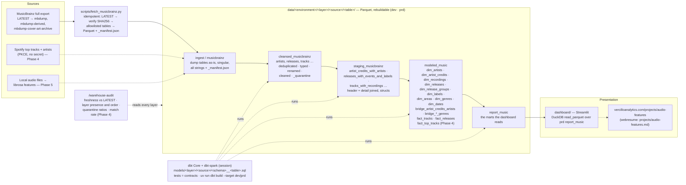

# Dataflow — audio_features

The one picture of the platform. The contracts behind every box live in
[`specs/music_data_platform_spec.yaml`](../specs/music_data_platform_spec.yaml), the one home;
this page draws them, and the notes below are pointers into it, not a second copy. Solid arrows
are built in Phases 2–3; dashed arrows are the later slices (Phase 4 Spotify, Phase 5 audio
features, Phase 6 presentation).

## Reading the diagram

- **The path is the address.** `data/<environment>/<layer>/<source>/<table>/` mirrors the
  `project.layer_source.table` pattern (`atz-data-hub-prd.cleansed_musicbrainz.artists`): the
  environment is a dbt target (`dev`, `prd`), the dbt schema is `<layer>_<source>`, and the
  table is bare and plural. `main` is the dev line; `prd` is promoted from it by PR.
- **One writer per layer.** The fetch script is the only writer of `ingest`; dbt (through the
  local Spark session) is the only writer of `cleansed`, `staging`, `modeled` and `report`.
  The audit reads every layer; the dashboard reads `report` only.
- **Names never repeat across layers.** `ingest` keeps the dump's singular names; `cleansed`
  pluralises and cleans; `staging` joins header and detail tables into new names; `modeled`
  adds `dim_` / `fact_` / `bridge_`. Row-count parity is therefore a dbt test per declared
  pair, not a name match.
- **Where sources meet.** Spotify and audio-feature tables enter at `ingest` under their own
  source folder, pass through their own `cleansed_<source>` and `staging_<source>` schemas,
  and are resolved to MusicBrainz records in `modeled` (ISRC first, then MusicBrainz ids).
  MusicBrainz is the source of truth; the others attach to it.
- **Keys.** `ingest` keeps the dump's `id` and `gid`; from `cleansed` onward they are
  `<entity>_id` and `<entity>_musicbrainz_id`. Both persist while an entity survives; merges and
  deletions retire rows, and the `gid_redirect` tables map a retired UUID to its successor, so
  anything that must outlive a refresh keys on the UUID.
- **Cadence.** Nothing is scheduled. The audit raises `DUMP_STALE` when the manifest's dump is
  not `LATEST`; the next session runs the fetch and `dbt build`.
- **Checkpoints.** 20%: a reviewer session after the first `cleansed` + `staging` build on a real
  dump. 80%: a reviewer session after the dashboard runs, before the site page is published.
